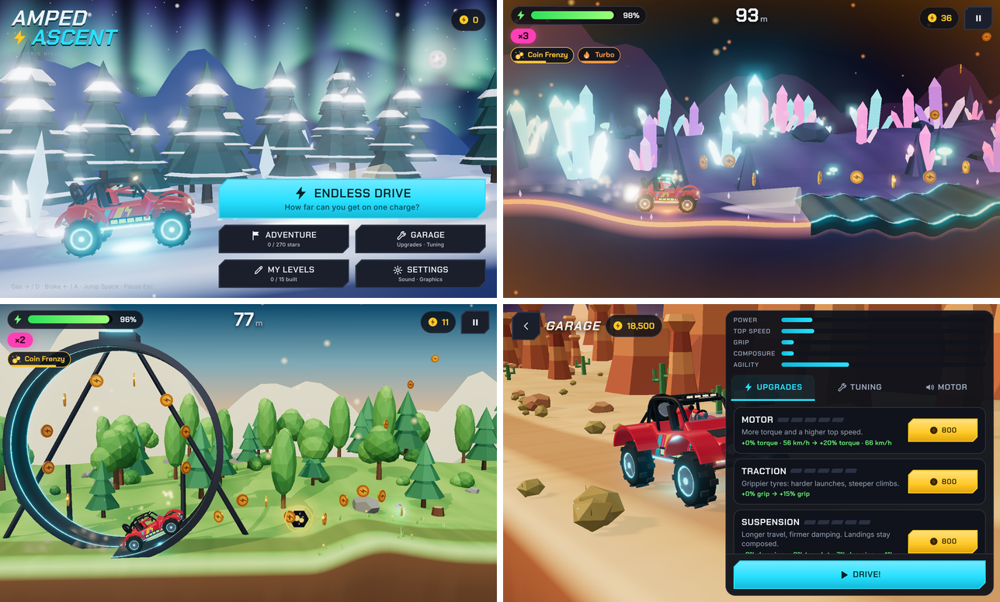

# Amped Ascent

An electric hill-climb driving game for the browser — phone or desktop. Built with
[three.js](https://threejs.org) and [planck.js](https://piqnt.com/planck.js) (Box2D).
Every model, texture, sound and note of music is generated from code.

**[Play it in your browser](https://glennbacon.github.io/arcade/amped-ascent/)** — it is one of the
games in [Glenn Bacon's arcade](https://glennbacon.github.io/arcade/).



- **Endless Drive** — one battery, six biomes that blend into each other, hills that keep growing.
- **Adventure** — 6 worlds × 15 generated levels, three mastery stars each.
- **Garage** — motor, traction, suspension and flip-control upgrades, four-wheel drive, a tuning
  bench with real trade-offs, and eight motor voices.
- **Power-ups** — Turbo, Magnet, Coin Frenzy, Wheelie Time, Flip Master, Jump Jets, Roll Bar,
  Super Sized, Stunt Fever.
- **Track furniture** — ramps, whoops, half-pipes, a plank bridge, and a corkscrew loop.
- **My Levels** — a level editor: drag the ground into shape, drop pickups and props, test-drive, save.

## Play

Play online at <https://glennbacon.github.io/arcade/amped-ascent/>, or run it from a copy of this
repository:

```sh
npm install
npm run dev      # http://localhost:5173
```

| | Keyboard | Touch | Gamepad |
|---|---|---|---|
| Gas (nose up in the air) | `→` / `D` | hold the right half | RT / stick right |
| Brake & reverse (nose down in the air) | `←` / `A` | hold the left half | LT / stick left |
| Jump Jets | `Space` | JUMP button | A |
| Pause | `Esc` / `P` | pause button | Start |

`npm run build` writes a static site to `dist/` that can be hosted anywhere (GitHub Pages, Netlify,
any file server); the arcade's copy is built this way. `npm run build:single` produces one
self-contained `dist-single/index.html`.

## Develop

```sh
npm test            # simulation rules + headless physics
npm run typecheck
npm run tune        # prints the numbers the car's feel is judged by
```

The simulation (`src/sim/`) has no rendering or DOM dependencies and runs in Node, so physics changes
are tested and tuned without opening a browser. See [`CLAUDE.md`](./CLAUDE.md) for the architecture,
the tuning knobs, the invariants, and the QA tooling.

## Licence

Amped Ascent is open source under the [MIT License](LICENSE). The game has no image, model or sound
files — its art and audio are made by the code — so the licence covers all of it.

[three.js](https://github.com/mrdoob/three.js) and [planck.js](https://github.com/piqnt/planck.js)
are not in this repository; `npm install` fetches them and the build includes them, each under its
own MIT licence. The fonts, [Chakra Petch](https://fonts.google.com/specimen/Chakra+Petch) and
[Inter](https://fonts.google.com/specimen/Inter), load from Google Fonts under the SIL Open Font
License.
